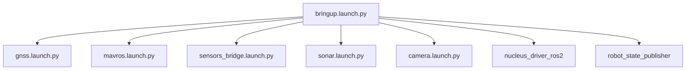

# mr_pinchy_bringup

ROS 2 (Humble) bringup package for **Mr Pinchy** — the single entry point for vehicle hardware: GNSS, FCU link (MAVROS), sonar, DVL, sensor bridges, and the robot description (`robot_state_publisher`).

## Prerequisites

- ROS 2 Humble
- A built workspace containing:
  - [ublox_dgnss](https://github.com/aussierobots/ublox_dgnss) (`ublox_dgnss`, `ublox_dgnss_node`, `ublox_nav_sat_fix_hp_node`)
  - `mavros`
  - `waterlinked_sonar_3d15`
  - `nucleus_driver_ros2` and `interfaces` (from [nucleus_driver](https://github.com/nortekgroup/nucleus_driver))
  - `smarc_msgs`

## Building

```bash
cd ~/sonar_ws
colcon build --packages-select mr_pinchy_bringup
source install/setup.bash
```

## Launch files

### Scope

| Launch file | Scope | Use when |
|---|---|---|
| `bringup.launch.py` | **Full vehicle** — GNSS, sonar, MAVROS, Nucleus DVL, camera, bridges, robot description | Default on-vehicle boot; one command for everything |
| `gnss.launch.py` | **GNSS only** — u-blox driver, NTRIP, NavSatFix | Testing GPS independently |
| `sonar.launch.py` | **Sonar only** — Water Linked 3D15 driver | Testing sonar independently |
| `imu.launch.py` | **IMU only** — STIM300 driver, sets the sensor sample rate | Testing the IMU independently |
| `camera.launch.py` | **Camera only** — auxiliary DWE exploreHD via `usb_cam` | Testing the camera independently |
| `mavros.launch.py` | **FCU link only** — PX4 MAVROS node | FCU debugging; included by bringup |
| `sensors_bridge.launch.py` | **Bridge nodes only** — DVL/depth/IMU/AHRS converters | Bridge debugging; included by bringup |
| `carl.launch.py` | **DVL + sonar + EKF** — Nucleus driver, Water Linked sonar, `nucleus_ekf.py`, `base_link` → `sonar_link` TF | DVL dead-reckoning with sonar, without GNSS or MAVROS |



### Full bringup

```bash
ros2 launch mr_pinchy_bringup bringup.launch.py
```

Launch profiles (set subsystem defaults; see [Vehicle configuration](#vehicle-configuration)):

| Profile | GNSS | Sonar | DVL | MAVROS | Camera | Use when |
|---|---|---|---|---|---|---|
| `full` (default) | on | on | on | on | on | Normal on-vehicle operation |
| `sensors_only` | off | on | on | on | on | GNSS already running or not needed |
| `gnss_only` | on | off | off | off | off | GPS testing only |
| `sim` | off | off | off | off | off | Bag replay — robot description and bridges only |

```bash
ros2 launch mr_pinchy_bringup bringup.launch.py profile:=sensors_only
ros2 launch mr_pinchy_bringup bringup.launch.py profile:=gnss_only
ros2 launch mr_pinchy_bringup bringup.launch.py profile:=sim
```

Arguments:

| Argument | Default | Description |
|---|---|---|
| `vehicle_config` | `config/pinchy.yaml` | Vehicle YAML (IPs, extrinsics, bridge defaults) |
| `secrets_file` | `config/secrets.yaml` | Secrets file (NTRIP credentials, Nucleus host and password) |
| `profile` | `full` | Launch preset: `full`, `sensors_only`, `gnss_only`, `sim` |
| `log_level` | `INFO` | ROS log level for GNSS nodes |
| `gnss` | _(empty)_ | Override GNSS enable (`true`/`false`; empty = use profile) |
| `sonar` | _(empty)_ | Override sonar enable |
| `dvl` | _(empty)_ | Override DVL enable |
| `mavros` | _(empty)_ | Override MAVROS enable |
| `camera` | _(empty)_ | Override camera enable |
| `nucleus_ip` | _(empty)_ | Nucleus DVL IP (empty = use `nucleus.host` from the secrets file) |
| `sonar_ip` | _(empty)_ | Water Linked sonar IP (empty = use vehicle config) |
| `fcu_url` | _(empty)_ | MAVROS FCU URL (empty = use vehicle config) |
| `sonar_params_file` | _(empty)_ | Optional sonar params YAML override (empty = use `pinchy.yaml` `sonar:` section) |

Disable individual subsystems (overrides profile):

```bash
ros2 launch mr_pinchy_bringup bringup.launch.py sonar:=false dvl:=false
```

### Sensors & FCU without GNSS

Use the `sensors_only` profile (or `gnss:=false`) when GNSS is already running elsewhere or not needed:

```bash
ros2 launch mr_pinchy_bringup bringup.launch.py profile:=sensors_only
ros2 launch mr_pinchy_bringup bringup.launch.py profile:=sim
```

Key topics started: MAVROS topics under `/mavros/`, sonar point cloud from `waterlinked_sonar_3d15`, Nucleus packets on `/nucleus_node/*`, bridged outputs on `/dvl/*` and `depth_odom`, camera images under `/explorehd/`.

`robot_state_publisher` publishes `/robot_description` and the fixed frames on `/tf_static`: `base_link` → `sonar_link`, `hd_camera_link`, `dvl_link`. The URDF is generated from the `extrinsics` section of the vehicle config, one fixed joint per entry, so a new sensor frame only needs a new entry there.

### GNSS

```bash
ros2 launch mr_pinchy_bringup gnss.launch.py
```

Arguments:

| Argument | Default | Description |
|---|---|---|
| `log_level` | `INFO` | ROS log level |
| `gnss_params_file` | `config/gnss.yaml` | Path to GNSS parameter overrides |
| `secrets_file` | `config/secrets.yaml` | Secrets file; NTRIP credentials are read from its `ntrip` section |

Verify output:

```bash
ros2 topic echo /fix
```

### Sonar

```bash
ros2 launch mr_pinchy_bringup sonar.launch.py
```

Arguments:

| Argument | Default | Description |
|---|---|---|
| `vehicle_config` | `config/pinchy.yaml` | Vehicle YAML with `sonar:` section |
| `sonar_ip` | _(empty)_ | Sonar IP override |
| `sonar_params_file` | _(empty)_ | Optional external params YAML override |
| `namespace` | _(empty)_ | Node namespace |

Verify output:

```bash
ros2 topic echo /sonar/point_cloud
```

### IMU

```bash
ros2 launch mr_pinchy_bringup imu.launch.py
```

Parameters live in [`config/imu.yaml`](config/imu.yaml). On start the driver sets the STIM300 sample rate (`configure_sample_rate`, 250 Hz by default) and low-pass filter (`configure_lp_filter`, 66 Hz by default) through the sensor's Service Mode. The `stim300` README lists every parameter and how to choose the filter for a sample rate. Without `save_config_to_flash` the setting lasts until the sensor is powered off, and is set again on every start. The driver needs `stim300` and `sam_msgs` in the workspace.

Arguments:

| Argument | Default | Description |
|---|---|---|
| `imu_params_file` | `config/imu.yaml` | IMU parameter YAML |
| `device` | _(empty)_ | Serial device override (empty = use params file) |
| `sample_rate` | _(empty)_ | Sensor sample rate override in Hz (empty = use params file) |
| `namespace` | `sam` | Node namespace |

Verify output:

```bash
ros2 topic hz /sam/core/imu
```

### Camera

The auxiliary DWE exploreHD camera, via `usb_cam`. It opens `/dev/explorehd_cam`, the symlink from the udev rule in [mr_pinchy `setup/udev`](https://github.com/PinchyFamily/mr_pinchy/tree/main/setup/udev). Driver settings are in `config/camera.yaml`; `frame_id` is taken from `extrinsics.camera.child_frame` in the vehicle config so images match the robot description.

```bash
ros2 launch mr_pinchy_bringup camera.launch.py
```

Arguments:

| Argument | Default | Description |
|---|---|---|
| `vehicle_config` | `config/pinchy.yaml` | Vehicle YAML (camera frame from `extrinsics.camera`) |
| `camera_params_file` | `config/camera.yaml` | `usb_cam` parameter file |
| `camera_name` | `explorehd` | Namespace; topics are published under `/<camera_name>/` |

`usb_cam` and the host's mavlink-camera-manager both open `/dev/explorehd_cam`, so only one can use the camera at a time. Launch with `camera:=false` when streaming it topside.

Verify output:

```bash
ros2 topic hz /explorehd/image_raw
```

### Sensor bridges

```bash
ros2 launch mr_pinchy_bringup sensors_bridge.launch.py
```

Arguments:

| Argument | Default | Description |
|---|---|---|
| `dvl_type` | `nucleus` | DVL model: `nucleus`, `waterlinked`, or `sim` |
| `dvl_topic` | _(empty)_ | DVL input topic override |
| `dvl_frame` | _(empty)_ | DVL TF frame override |
| `depth_topic` | _(empty)_ | Depth input topic override |
| `depth_frame` | _(empty)_ | Depth output frame override |
| `relative_depth` | `True` | Treat depth as relative (offset on first reading) |
| `ned` | `True` | Depth reading is in NED frame |
| `ahrs` | `False` | Enable Nucleus AHRS bridge |

When launched via `bringup.launch.py`, bridge settings come from `config/pinchy.yaml` under the `bridges:` key.

Note: only Nucleus bridge executables are installed in this package. Selecting `waterlinked` or `sim` for `dvl_type` will fail at runtime.

## Vehicle configuration

Vehicle-specific settings live in [`config/pinchy.yaml`](config/pinchy.yaml). Edit this file instead of hardcoding values in launch files.

| Section | Contents |
|---|---|
| `network` | MAVROS FCU URL, DVL connect delays (Nucleus host and password are in `secrets.yaml`) |
| `sonar` | Water Linked sonar IP, UDP/network, acoustics, and topic names |
| `subsystems` | Default enable flags for GNSS, sonar, DVL, MAVROS |
| `extrinsics` | Sensor frames relative to `base_link`. The axis convention is provisional: the values read as FRD (x forward, y right, z down), like the `nucleus_ekf.py` output, but this is unconfirmed and REP-103 expects FLU. `xyz` in m, `rpy` = roll, pitch, yaw in rad; every entry becomes a fixed joint in the robot description |
| `bridges` | DVL type, frames, depth topic, AHRS enable |

Sonar `frame_id` defaults to `extrinsics.sonar.child_frame` when left empty in `pinchy.yaml`. Set `sonar.params_file` to an external YAML (same format as `config/sonar.yaml`) to replace the inline `sonar:` block entirely.

Use a custom config file at launch time:

```bash
ros2 launch mr_pinchy_bringup bringup.launch.py vehicle_config:=/path/to/my_vehicle.yaml
```

Launch arguments override config values when set explicitly (non-empty). Profiles override `subsystems` defaults unless individual `gnss`/`sonar`/`dvl`/`mavros`/`camera` args are passed.

## Bridge nodes

Python bridge nodes in `scripts/` convert vendor-specific messages to standard ROS types:

| Node | Input topic(s) | Output topic | Message types | Purpose |
|---|---|---|---|---|
| `nucleus_dvl_bridge` | `/nucleus_node/bottom_track_packets` | `/dvl/velocity` | `interfaces/BottomTrack` → `TwistWithCovarianceStamped` | Nucleus bottom-track velocity to standard DVL twist |
| `depth_bridge` | `/global_position/rel_alt` (+ `global_position/global` for stamp) | `depth_odom` | `Float64` → `PoseWithCovarianceStamped` | FCU relative altitude to depth pose (z only) |
| `nucleus_imu_bridge` | `/nucleus_node/imu_packets` | `/dvl/imu` | `interfaces/IMU` → `sensor_msgs/Imu` | Raw Nucleus IMU to standard Imu |
| `nucleus_ahrs_bridge` | `/nucleus_node/ahrs_packets` | `/dvl/ahrs_imu` | `interfaces/AHRS` → `sensor_msgs/Imu` | Nucleus AHRS orientation to Imu (orientation only) |

Each node accepts ROS parameters to override `frame_id`, input/output topics, and other settings. See the node source in `scripts/` for the full parameter list.

### Nucleus EKF

`nucleus_ekf.py` (started by `carl.launch.py`) is a 12-state EKF (position, attitude, linear and angular velocity) that fuses Nucleus AHRS attitude (`/nucleus_node/ahrs_packets`) with bottom-track velocity (`/nucleus_node/bottom_track_packets`). It publishes `/nortek_dvl_ekf/odom` and the `odom` → `base_link` TF. The state is kept in NED; `odom` is published as ENU and `base_link` as FRD (not the REP-103 FLU convention). Position is dead-reckoned from DVL velocity only, so it drifts.

## Package dependencies

### This package provides

- Launch orchestration for Mr Pinchy
- Sensor bridge nodes (DVL, depth, IMU, AHRS)
- GNSS NTRIP client script

### Required workspace packages

| Package | Role |
|---|---|
| `ublox_dgnss`, `ublox_dgnss_node`, `ublox_nav_sat_fix_hp_node` | GNSS driver stack |
| `mavros` | FCU communication (PX4) |
| `waterlinked_sonar_3d15` | 3D sonar driver |
| `nucleus_driver_ros2`, `interfaces` | Nortek Nucleus DVL driver + messages |
| `usb_cam`, `image_transport` | exploreHD camera driver (`ros-humble-usb-cam`) |
| `smarc_msgs` | SMARC message types used by DVL bridge |

### ROS / system dependencies

Declared in `package.xml`:

- `launch`, `launch_ros`, `launch_xml`, `ament_index_python`, `rclpy`
- `tf2_ros`, `robot_state_publisher`
- `geometry_msgs`, `nav_msgs`, `sensor_msgs`, `std_msgs`, `rtcm_msgs`
- `python3-numpy`, `python3-yaml`

## Configuration

Vehicle-specific parameters live in `config/`. Edit these instead of modifying launch files.

| File | Purpose |
|---|---|
| `pinchy.yaml` | Vehicle network IPs, sonar driver settings, extrinsics, bridge defaults, subsystem enables |
| `camera.yaml` | `usb_cam` settings for the exploreHD camera (device, resolution, pixel format, image controls) |
| `sonar.yaml` | Optional legacy sonar params file (use via `sonar.params_file` or `sonar_params_file:=`) |
| `gnss.yaml` | u-blox device family, measurement rates, USB message outputs, non-secret NTRIP settings (reference position, GGA interval) |
| `secrets.yaml` | **Untracked.** All vehicle credentials in one place (see below) |
| `imu.yaml` | STIM300 serial device, sensor sample rate and LP filter, message frame, topic and covariances |

### Secrets

Every credential the vehicle needs lives in one gitignored file, `config/secrets.yaml`. Create it from the tracked template:

```bash
cp config/secrets.yaml.example config/secrets.yaml
chmod 600 config/secrets.yaml
```

| Section | Used by |
|---|---|
| `ntrip` | `gnss.launch.py` (`ntrip_client` node), `scripts/test_ntrip.py` |
| `nucleus` | `bringup.launch.py`, `carl.launch.py` (Nucleus `connect_tcp` host and password) |
| `access_point` | `mr_pinchy/setup/ap/install-ap.sh` (`pinchy-ap` passphrase) |
| `wifi` | Lab Wi-Fi client (Imager / netplan), reference only |
| `modem` | 4G modem APN / SIM PIN, reference only |

Older files in ROS params format (`ntrip_client: ros__parameters:`) are still read by `gnss.launch.py` and `test_ntrip.py`.

## Hardware

### GNSS (u-blox)

The u-blox receiver appears as `/dev/gnss0` → `/dev/ttyACM0` over USB. No udev rules are needed for basic operation, but if the device index changes you can add a rule:

```
# /etc/udev/rules.d/99-ublox.rules
SUBSYSTEM=="tty", ATTRS{idVendor}=="1546", ATTRS{idProduct}=="*", SYMLINK+="ublox_gnss", MODE="0666"
```

Then reload with `sudo udevadm control --reload-rules && sudo udevadm trigger`.

### Nucleus DVL

Host and password are read from the `nucleus` section of `config/secrets.yaml`; connect timing is set in `config/pinchy.yaml` under `network:`. Override the host at launch with `nucleus_ip:=192.168.x.x`. The driver connects automatically after `nucleus_connect_delay` seconds (default 3) and begins streaming after `nucleus_start_delay` seconds (default 6).

### Sonar

Water Linked 3D15 settings are in `config/pinchy.yaml` under `sonar:` (IP, interface, UDP mode, acoustics). Launch sonar alone with `ros2 launch mr_pinchy_bringup sonar.launch.py`, or override the IP at full bringup with `sonar_ip:=192.168.x.x`. Static extrinsic is under `extrinsics:` in the same file.
